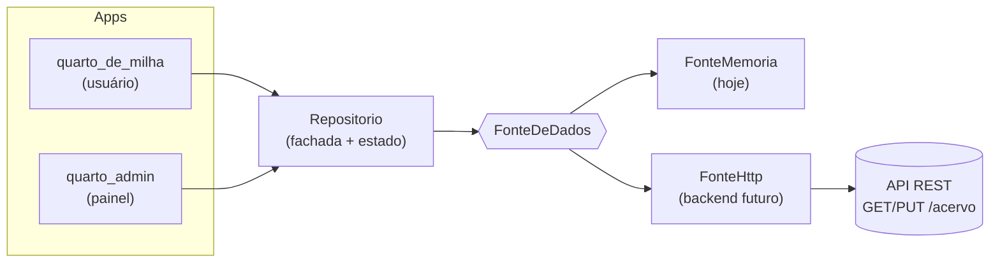
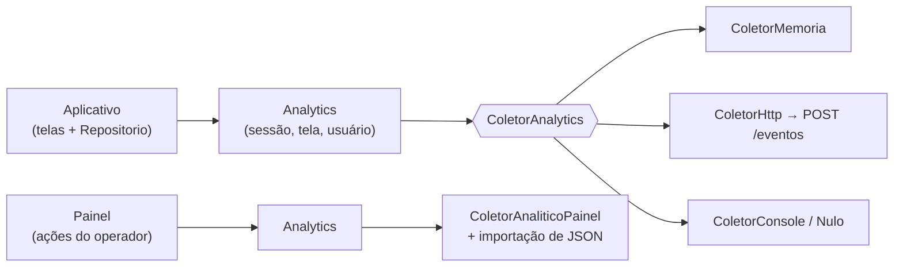

# Quarto de Milha — arquitetura

Dois aplicativos Flutter Web e um pacote compartilhado. O app do usuário consulta
o acervo; o painel administrativo edita. Ambos falam com a **mesma** `FonteDeDados`,
então trocar mock por banco de dados é trocar uma implementação.

```
horse-igor/
├── pacotes/quarto_core/     modelos, contrato de fonte e fachada (sem UI)
├── quarto_de_milha/         aplicativo do usuário (web, Android, iOS)
└── quarto_admin/            painel administrativo (web)
```

## Como os dados fluem



O `Repositorio` aplica a alteração na hora (resposta imediata na tela) e depois
persiste na fonte. Se a gravação falhar, `rep.erro` é preenchido e o painel mostra
a mensagem — o dado local não é revertido, evitando perder o que o operador digitou.

### O que a fonte em memória faz e não faz

`FonteMemoria` guarda o acervo **na memória do processo**. Consequências práticas:

- Recarregar a página restaura o estado inicial — as edições se perdem.
- Duas abas, dois navegadores ou dois aparelhos têm acervos **independentes**:
  editar no painel de um não altera o app aberto no outro.

Isso é proposital: é a fonte de demonstração, sem servidor. Para que painel e app
compartilhem o mesmo acervo de verdade, é preciso uma fonte com estado
compartilhado — que é exatamente o que `FonteHttp` (ou qualquer backend, inclusive
um arquivo JSON servido por um processo) oferece. O painel administrativo torna essa
troca verificável: exporte o JSON de um lado e importe no outro.

## O contrato

Toda origem de dados implementa quatro membros:

```dart
abstract interface class FonteDeDados {
  String get descricao;            // exibido no painel
  bool get permiteEscrita;         // false => painel em modo leitura
  Future<Acervo> carregar();       // GET /acervo
  Future<Acervo> salvar(Acervo);   // PUT /acervo
}
```

O agregado `Acervo` carrega `cavalos`, `baias` e uma `versao` incremental:

```json
{
  "versao": 3,
  "cavalos": [ { "id": "...", "nome": "...", "provas": [], "midias": [] } ],
  "baias":   [ { "numero": "01", "cavaloId": "...", "manejo": [] } ]
}
```

Todos os modelos têm `fromJson`/`toJson` e toleram campos ausentes ou inválidos:
enum desconhecido cai no padrão, data inválida vira `1970-01-01`. Isso significa que
um backend pode evoluir o esquema sem derrubar o aplicativo.

## Trocar a fonte

Nada de código muda — só a compilação:

```bash
# Demonstração (padrão): dados em memória
flutter build web --release

# Backend real
flutter build web --release \
  --dart-define=QUARTO_FONTE=http \
  --dart-define=QUARTO_API=https://api.seu-haras.app \
  --dart-define=QUARTO_TOKEN=seu-token

# Endereço exibido no QR Code da placa
--dart-define=QUARTO_SITE=https://seu-dominio.app
```

| Define | Padrão | Uso |
| --- | --- | --- |
| `QUARTO_FONTE` | `memoria` | `memoria` ou `http` |
| `QUARTO_API` | vazio | raiz da API (obrigatório com `http`) |
| `QUARTO_TOKEN` | vazio | enviado como `Authorization: Bearer …` |
| `QUARTO_SITE` | `https://quartodemilha.app.br` | base do link no QR Code |

## O que o backend precisa implementar

O contrato mínimo são duas rotas:

| Método | Rota | Corpo | Resposta |
| --- | --- | --- | --- |
| `GET` | `/acervo` | — | acervo em JSON |
| `PUT` | `/acervo` | acervo em JSON | acervo gravado (pode normalizar e incrementar `versao`) |

Gravar o acervo inteiro a cada alteração é simples e suficiente para o volume de um
haras. Quando isso pesar, implemente uma `FonteDeDados` com rotas por recurso
(`PUT /cavalos/:id`) — o painel e o app continuam iguais, porque nenhum deles
conhece a forma da API.

### Migrar dados entre fontes

O painel tem a tela **Fonte de dados**, que:

1. **Exporta** o acervo atual em JSON (copiar ou visualizar).
2. **Importa** um JSON colado, substituindo todo o acervo e gravando na fonte ativa.

Fluxo típico: rode com `QUARTO_FONTE=memoria`, exporte, suba o backend, rode com
`http`, importe o mesmo JSON. Nenhum arquivo intermediário.

## Verificação

```bash
cd pacotes/quarto_core && flutter test   # contrato, serialização, regras
cd quarto_de_milha       && flutter test   # telas do usuário
cd quarto_admin          && flutter test   # telas do painel
```

## Executar localmente

```bash
# Painel administrativo
cd quarto_admin && flutter run -d chrome

# Aplicativo do usuário
cd quarto_de_milha && flutter run -d chrome
```

Para builds locais servidos por HTTP, use `ferramentas/servir.py` na raiz.

## Analytics

A telemetria é genérica o bastante para cobrir uso do aplicativo hoje e, amanhã,
pagamentos, funil de conversão e retenção — sem mudar o núcleo.

### O evento

Um evento é um fato datado com contexto e um mapa livre de propriedades:

```json
{
  "nome": "manejo_alternado",
  "quando": "2026-10-16T11:02:14.000Z",
  "sessao": "ses-m9x2k",
  "tela": "/baias",
  "entidade": "baia",
  "entidadeId": "01",
  "valor": 1,
  "propriedades": { "tarefa": "Ração da manhã", "concluida": true, "rotinaCompleta": false }
}
```

| Campo | Para que serve |
| --- | --- |
| `nome` | texto livre, `snake_case` — `cavalo_criado`, `pagamento_aprovado` |
| `sessao` | funil e retenção dependem de agrupar por sessão |
| `valor` | medida numérica: preço, tempo de prova, quantidade |
| `entidade` / `entidadeId` | liga o evento a um objeto do domínio |
| `propriedades` | qualquer coisa específica do evento, sem migração de esquema |

Campos ausentes e enums desconhecidos não quebram a leitura: o modelo cai em
valores padrão, então um backend pode evoluir o esquema à frente do aplicativo.

### Onde os eventos vão



Os três coletores prontos, escolhidos por compilação:

```bash
--dart-define=QUARTO_ANALYTICS=memoria   # padrão: guarda na sessão
--dart-define=QUARTO_ANALYTICS=console   # imprime no console
--dart-define=QUARTO_ANALYTICS=nulo      # desliga
--dart-define=QUARTO_ANALYTICS=http \
  --dart-define=QUARTO_API_EVENTOS=https://api.haras.app
```

`ColetorComposto` permite gravar em memória **e** enviar para a API ao mesmo tempo.

### Telemetria nunca derruba o usuário

O contrato é explícito: `registrar` não lança. Uma exceção no destino é capturada
e guardada em `ultimoErro`. Há teste com um coletor que sempre explode, provando
que `registrar`, `visitar` e `pagamento` retornam normalmente.

Além disso, o `Repositorio` só emite o evento **depois** de a gravação dar certo:
a telemetria descreve o que aconteceu, não o que se tentou fazer.

### Instrumentar domínios novos

Nada de esquema fixo. Para pagamentos:

```dart
analytics.pagamento('mensalidade', 14990, status: 'aprovado', cobrancaId: 'cob-1');
// → evento pagamento_aprovado, valor 149.90, entidade cobranca
```

Para um funil, basta marcar cada passo:

```dart
analytics.funil('assinatura', 'plano_escolhido', valor: 149.90);
analytics.funil('assinatura', 'dados_pagamento');
analytics.funil('assinatura', 'pagamento_aprovado');
```

O painel descobre o funil e suas etapas sozinho, e calcula a conversão entre elas.
O mesmo vale para retenção: agrupa as sessões pelo primeiro dia em que apareceram,
para qualquer evento que se repita — uso, compra, login.

### O painel

| Aba | Conteúdo |
| --- | --- |
| Visão geral | eventos, sessões, usuários, duração média, série por dia, eventos mais frequentes e valores somados |
| Eventos | lista paginada com busca livre e filtro por tipo; abre o detalhe com propriedades e JSON |
| Funil | escolha do funil e das etapas, com conversão e perda por passo |
| Retenção | matriz de coortes por dia de primeiro uso, com janela configurável |
| Origem | de onde vêm os eventos, sessões observadas e exportação em JSON |

### Levar eventos do aplicativo para o painel

Hoje, sem backend de eventos, há dois caminhos:

1. **Importar JSON** — a aba Origem exporta os eventos; a tela Analytics do painel
   importa o mesmo JSON (aceita `{"eventos": […]}` ou uma lista solta).
2. **Apontar os dois para o mesmo serviço** — compile ambos com
   `QUARTO_ANALYTICS=http` e `QUARTO_API_EVENTOS`. O contrato do serviço é uma
   rota: `POST /eventos` recebendo `{"eventos": [Evento, ...]}`.
